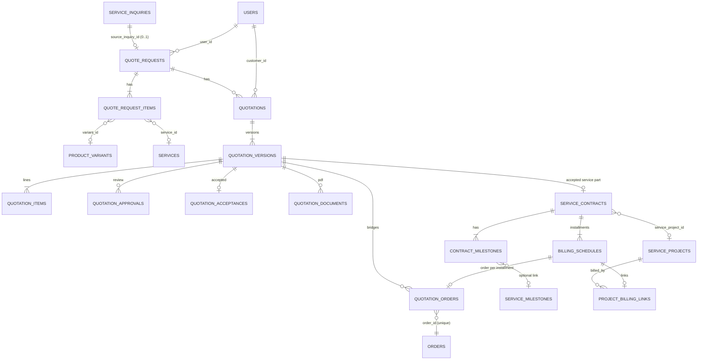
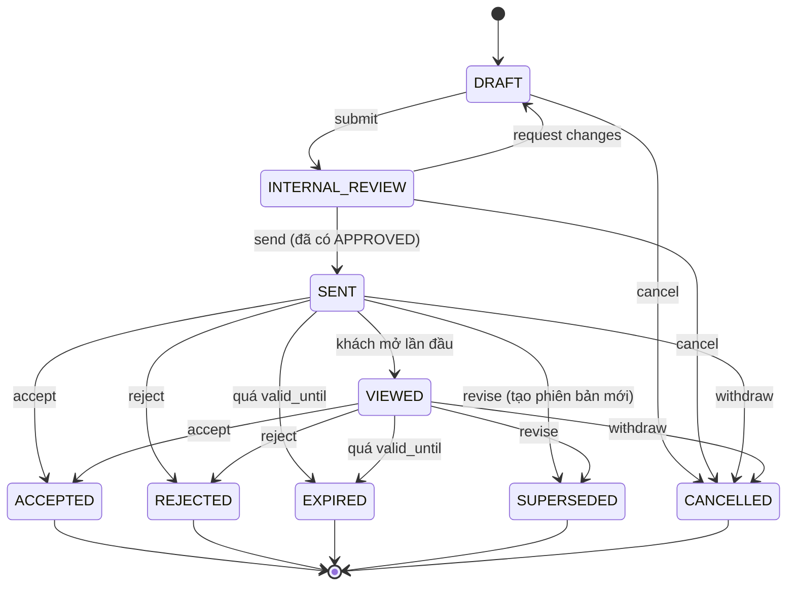
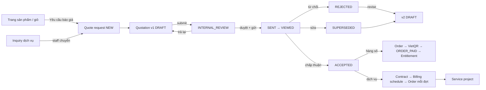

# RFC — Unified Quotation (Báo giá hợp nhất)

| Mục | Giá trị |
|---|---|
| Trạng thái | **ĐỀ XUẤT** — chưa triển khai, không có migration/code trong PR #27 |
| Ngày | 2026-10-16 |
| Nền tảng | `main` `1237c8c` + PR #27 `eec160a` (Services Foundation) |
| Nhánh đề xuất | `feat/unified-quotation` (chỉ bắt đầu sau khi PR #27 được review/merge) |
| Feature flag đề xuất | `FEATURE_QUOTATIONS` (tắt mặc định ở production, cùng cơ chế `packages/utils/src/feature-flags.ts`) |

> Mọi số tiền, thuế suất, ngưỡng duyệt trong tài liệu này là **ký hiệu** (`P₁`, `t`, `T`…). Không có mức giá, thuế suất hay quy định pháp lý nào được giả định. Các điểm cần chủ dự án/kế toán/pháp chế quyết định được liệt kê ở §22.

---

## 1. Business requirements

PGS bán ba loại thứ:

1. **Sản phẩm số giá cố định** — Theme, Plugin, Template/UI Kit (đã có: catalog → cart → checkout → SePay/Stripe → entitlement).
2. **Dịch vụ theo yêu cầu** — Custom Website/Web App, AI Chatbot, Messenger/Zalo Automation, Custom Plugin, Business Automation, API Integration (PR #27: inquiry → project).
3. **Gói kết hợp** — ví dụ Theme + Plugin + tùy chỉnh + triển khai.

Ba hình thức kinh doanh, áp dụng cho từng sản phẩm/dịch vụ:

| Mode | Ý nghĩa | Hiện trạng |
|---|---|---|
| `DIRECT_PURCHASE` | mua ngay qua checkout hiện tại | mặc định của mọi `Product`; `Service.pricingMode = DIRECT_CHECKOUT` |
| `QUOTE_REQUIRED` | gửi yêu cầu → PGS báo giá | `Service.pricingMode = QUOTE_REQUIRED`; sản phẩm chưa hỗ trợ |
| `BOTH` | mua ngay hoặc xin báo giá riêng (nhiều license, tùy chỉnh, kèm dịch vụ) | chưa có |

Yêu cầu bắt buộc:
- Một báo giá có thể chứa nhiều hạng mục thuộc nhiều loại (biến thể sản phẩm, dịch vụ, hạng mục tùy chỉnh).
- Báo giá đã gửi là **bất biến**; muốn sửa phải tạo phiên bản mới.
- Chấp thuận báo giá **không** đồng nghĩa với thanh toán; thanh toán thành công **không** đồng nghĩa với nghiệm thu; license chỉ được cấp sau khi thanh toán được xác minh (giữ nguyên invariant hiện tại).
- PDF báo giá sinh từ dữ liệu backend đã chốt, lưu private, chỉ người có quyền mới tải được.

### 1.1 Phân biệt khái niệm

| Khái niệm | Thực thể | Sinh ra khi | Không phải là |
|---|---|---|---|
| Inquiry | `service_inquiries` (đã có) | khách gửi form tư vấn | đơn hàng, báo giá |
| Quote Request | `quote_requests` (+ items) | khách xin báo giá có hạng mục cụ thể, hoặc staff chuyển từ inquiry | báo giá |
| Quotation | `quotations` | staff lập báo giá cho một quote request | cam kết thanh toán |
| Quote Version | `quotation_versions` (+ items) | mỗi lần lập/sửa nội dung; bất biến sau khi gửi | — |
| Quote Acceptance | `quotation_acceptances` | khách chấp thuận một phiên bản cụ thể | thanh toán |
| Contract | `service_contracts` (+ milestones) | phần dịch vụ của báo giá đã chấp thuận cần hợp đồng | nghiệm thu |
| Order | `orders` (đã có) | mỗi lần cần thu tiền (hàng số, hoặc một đợt thanh toán dịch vụ) | quyền sử dụng |
| Payment | `payments` (đã có) | khách chuyển khoản/thanh toán; xác minh bằng webhook | nghiệm thu |
| Project | `service_projects` (đã có) | công việc phát triển/bàn giao | thanh toán |
| Entitlement | `entitlements` (đã có) | worker cấp sau `ORDER_PAID` từ snapshot `order_items` | — |

**Một đường tiếp nhận:** `service_inquiries` vẫn là form tư vấn duy nhất cho dịch vụ. `quote_requests` là yêu cầu có cấu trúc (có hạng mục, số lượng); nó được tạo từ trang sản phẩm/giỏ hàng, hoặc do staff chuyển từ một inquiry (`source_inquiry_id`). Không tạo thêm form/endpoint tiếp nhận thứ ba (thay cho `POST /v1/leads` mà B2 đề xuất — xem [kế hoạch tích hợp §7](../frontend/pgs-integration-plan.md)).

---

## 2. User roles

| Vai trò | Role hiện có | Quyền mới đề xuất |
|---|---|---|
| Khách vãng lai | (ẩn danh) | gửi quote request có giới hạn (D-8) |
| Khách hàng | `customer` | xem/chấp thuận/từ chối báo giá **của mình** (theo sở hữu, không cần permission) |
| Nhân viên kinh doanh/hỗ trợ | `support_agent` | `quote.read`, `quote.manage` |
| Quản lý sản phẩm | `product_manager` | `quote.read` |
| Kế toán | `finance` | `quote.read`, `quote.approve`, `billing.manage` |
| Vận hành | `ops` | `quote.read`, `contract.manage` |
| Admin | `admin` | tất cả quyền mới |
| Super admin | `super_admin` | tất cả (pass mọi kiểm tra, như hiện tại) |

Quyền mới: `quote.read`, `quote.manage`, `quote.approve`, `contract.manage`, `billing.manage`. Gán cho role qua `ROLE_PERMISSION_MAP` (chỉ thêm, không xóa mục nào).

---

## 3. User stories

| # | Là… | Tôi muốn… | Để… |
|---|---|---|---|
| US-01 | khách | bấm "Yêu cầu báo giá" trên trang Plugin khi cần 25 site | được giá cho số lượng lớn |
| US-02 | khách | gửi một yêu cầu gồm Theme + Plugin + tùy chỉnh | nhận một báo giá trọn gói |
| US-03 | staff | chuyển một inquiry dịch vụ thành quote request | không phải nhập lại thông tin |
| US-04 | staff | lập báo giá nhiều hạng mục, giá gợi ý từ catalog | báo giá nhanh, nhất quán |
| US-05 | staff | gửi báo giá đi duyệt nội bộ trước khi gửi khách | tránh sai giá/chiết khấu |
| US-06 | kế toán | duyệt hoặc trả lại báo giá vượt ngưỡng chiết khấu | kiểm soát biên lợi nhuận |
| US-07 | staff | gửi báo giá kèm PDF | khách có văn bản chính thức |
| US-08 | khách | xem báo giá và tải PDF trong Portal | đối chiếu nội bộ |
| US-09 | khách | chấp thuận đúng phiên bản tôi đã xem | không bị đổi nội dung sau khi đồng ý |
| US-10 | khách | từ chối kèm lý do | PGS điều chỉnh |
| US-11 | staff | sửa báo giá đã gửi bằng phiên bản mới | giữ lịch sử, phiên bản cũ bị thay thế |
| US-12 | hệ thống | đánh dấu báo giá hết hạn | không chấp thuận được báo giá quá hạn |
| US-13 | khách | sau khi chấp thuận, thanh toán phần sản phẩm số qua checkout VietQR hiện có | nhận license như mua thường |
| US-14 | khách | thanh toán dịch vụ theo từng đợt | phù hợp tiến độ dự án |
| US-15 | staff | gắn báo giá dịch vụ đã chấp thuận với dự án và hợp đồng | theo dõi thu tiền theo milestone |

---

## 4. Data model

Mọi bảng là **mới** (additive). Không thêm cột vào `products`, `orders`, `order_items`, `payments`, `entitlements`, `service_inquiries`, `service_projects`. Liên kết với bảng cũ bằng khóa ngoại **trên bảng mới**. Tiền lưu `Int` theo đơn vị nhỏ nhất của tiền tệ, giống `order_items.unit_amount` hiện tại.

### 4.1 Enum mới

```text
CommercialMode        DIRECT_PURCHASE | QUOTE_REQUIRED | BOTH
QuoteRequestSource    PRODUCT_PAGE | CART | SERVICE_INQUIRY | STAFF
QuoteRequestStatus    NEW | IN_REVIEW | QUOTED | CLOSED | SPAM
QuoteItemType         PRODUCT_VARIANT | SERVICE | CUSTOM
QuotationStatus       DRAFT | INTERNAL_REVIEW | SENT | VIEWED | ACCEPTED | REJECTED | EXPIRED | SUPERSEDED | CANCELLED
QuoteApprovalAction   SUBMITTED | APPROVED | CHANGES_REQUESTED
QuoteDocumentKind     QUOTE_PDF | ATTACHMENT
ContractStatus        DRAFT | PENDING_SIGNATURE | ACTIVE | COMPLETED | TERMINATED
ContractMilestoneTrigger  ON_SIGNATURE | ON_MILESTONE_ACCEPTANCE | ON_DATE
BillingStatus         SCHEDULED | ORDER_CREATED | PAID | WAIVED | CANCELLED
```

Mở rộng enum hiện có (migration riêng, additive): `ServicePricingMode` thêm `BOTH`.

### 4.2 Bảng

| Bảng | Cột chính | Ràng buộc / index |
|---|---|---|
| `product_commercial_settings` | `product_id` (PK, FK `products` CASCADE), `mode CommercialMode`, `quote_note`, `updated_by_id`, timestamps | không sửa `products`; thiếu dòng = `DIRECT_PURCHASE` |
| `quote_requests` | `id`, `request_number` (`QR-YYYYMM-XXXXXX`), `source`, `source_inquiry_id` (FK `service_inquiries` SET NULL), `user_id` (FK `users` SET NULL), `company_name`, `contact_name`, `contact_email`, `contact_phone`, `message`, `status`, `submission_key`, `ip_hash`, `tenant_id` (nullable, chưa FK — §4.4), `assigned_to_id`, timestamps | UNIQUE `request_number`, `submission_key`, `source_inquiry_id`; index `(status, created_at)`, `user_id`, `contact_email` |
| `quote_request_items` | `id`, `quote_request_id` (CASCADE), `item_type`, `product_id`, `variant_id`, `service_id`, `description`, `quantity`, `customer_note`, `sort_order` | CHECK đúng FK theo `item_type` (raw SQL trong migration); `quantity > 0`; index `quote_request_id` |
| `quotations` | `id`, `quotation_number` (`Q-YYYYMM-XXXXXX`), `quote_request_id` (FK RESTRICT), `customer_id` (FK `users` RESTRICT, nullable khi DRAFT), `currency`, `status` (bản sao trạng thái của phiên bản hiện hành), `current_version_id`, `tenant_id`, `created_by_id`, timestamps | UNIQUE `quotation_number`; index `customer_id`, `(status, updated_at)`, `quote_request_id` |
| `quotation_versions` | `id`, `quotation_id` (CASCADE), `version_no`, `status`, `valid_until`, `currency`, `subtotal_minor`, `discount_minor`, `tax_minor`, `total_minor`, `tax_profile_code`, `terms_text`, `payment_plan` (JSON mẫu đợt thanh toán), `snapshot_hash`, `sent_at`, `sent_by_id`, `viewed_at`, `decided_at`, `decided_by_id`, `decision_note`, `supersedes_version_id`, `created_by_id`, timestamps | UNIQUE `(quotation_id, version_no)`; **UNIQUE một phiên bản `ACCEPTED`/quotation** (partial index `WHERE status = 'ACCEPTED'`); **UNIQUE một phiên bản đang mở** (`WHERE status IN ('SENT','VIEWED')`); trigger chặn UPDATE cột giá/nội dung khi `sent_at IS NOT NULL` (§10) |
| `quotation_items` | `id`, `version_id` (CASCADE), `line_no`, `item_type`, `product_id`, `variant_id`, `service_id`, `license_plan_id`, `title`, `description`, `quantity`, `unit_price_minor`, `discount_minor`, `tax_rate_bp`, `tax_minor`, `line_total_minor`, `fulfillment_kind` (`DIGITAL_ENTITLEMENT` / `SERVICE_DELIVERY`), snapshot quyền: `is_lifetime`, `duration_days`, `duration_months`, `max_activations`, `updates_days`, `support_days`, `price_override_reason` | UNIQUE `(version_id, line_no)`; CHECK FK theo `item_type`; CHECK `line_total_minor = quantity * unit_price_minor - discount_minor + tax_minor` |
| `quotation_approvals` | `id`, `version_id` (CASCADE), `action`, `actor_id` (FK `users` RESTRICT), `note`, `created_at` | index `version_id` — chỉ thêm, không sửa/xóa |
| `quotation_acceptances` | `id`, `version_id` (UNIQUE, RESTRICT), `user_id` (RESTRICT), `accepted_snapshot_hash`, `terms_version`, `ip_hash`, `user_agent`, `created_at` | bằng chứng chấp thuận, bất biến |
| `quotation_documents` | `id`, `version_id` (CASCADE), `kind`, `storage_key`, `sha256`, `size_bytes`, `mime_type`, `generated_by` (`SYSTEM`/`STAFF`), `created_at` | UNIQUE `storage_key`; UNIQUE `(version_id)` khi `kind = QUOTE_PDF` |
| `quotation_orders` | `id`, `version_id` (RESTRICT), `order_id` (UNIQUE, FK `orders` RESTRICT), `purpose` (`DIGITAL_ITEMS` / `INSTALLMENT`), `billing_schedule_id` (UNIQUE, nullable), `created_at` | cầu nối tới đơn hàng — **không thêm cột vào `orders`** |
| `service_contracts` | `id`, `contract_number`, `quotation_version_id` (UNIQUE, RESTRICT), `customer_id` (RESTRICT), `service_project_id` (UNIQUE nullable, SET NULL), `status`, `total_minor`, `currency`, `signed_at`, `document_id`, `created_by_id`, timestamps | UNIQUE `contract_number`; index `customer_id`, `status` |
| `contract_milestones` | `id`, `contract_id` (CASCADE), `sequence`, `title`, `amount_minor`, `trigger`, `due_date`, `service_milestone_id` (FK `service_milestones` SET NULL), `status` | UNIQUE `(contract_id, sequence)`; tổng `amount_minor` = `service_contracts.total_minor` (kiểm ở service + test) |
| `billing_schedules` | `id`, `contract_id` (RESTRICT), `contract_milestone_id` (UNIQUE nullable), `installment_no`, `label`, `amount_minor`, `currency`, `due_at`, `status`, timestamps | UNIQUE `(contract_id, installment_no)`; index `(status, due_at)` |
| `project_billing_links` | `id`, `service_project_id` (CASCADE), `billing_schedule_id` (UNIQUE, CASCADE), `created_at` | nhiều hợp đồng (change request) cho một dự án |

### 4.3 Snapshot giá

- **Lúc lập phiên bản:** giá gợi ý lấy từ `product_prices` (biến thể + tiền tệ) hoặc do staff nhập cho `SERVICE`/`CUSTOM`. Điều khoản license sao chép từ `license_plans` của biến thể vào cột snapshot của `quotation_items`.
- **Lúc gửi (`SENT`):** tính lại toàn bộ tổng ở backend, ghi `snapshot_hash = sha256(JSON chuẩn hóa của phiên bản + hạng mục)`, khóa phiên bản.
- **Lúc chấp thuận:** khách gửi kèm `versionId` + `snapshotHash` đang xem; backend so khớp, không khớp → 409.
- **Lúc tạo đơn:** `order_items` được dựng từ snapshot của `quotation_items` (giá, số lượng, quyền), không đọc lại catalog — đúng nguyên tắc *Legacy Order Policy / ZERO mutable catalog fallback* trong `PROJECT_CONTEXT.md`.

### 4.4 Ownership và multi-tenant

- Hiện tại: sở hữu theo `users.id` (`quote_requests.user_id`, `quotations.customer_id`), giống Orders/Tickets/Services.
- Báo giá chỉ được gửi (`SENT`) khi đã gắn `customer_id` của một **tài khoản đã tồn tại**. Quote request ẩn danh được staff gắn tài khoản giống cách chuyển inquiry ẩn danh thành dự án trong PR #27 (không tự liên kết theo email chưa xác minh).
- Mở rộng tổ chức (sau PR #23): cột `tenant_id` nullable có sẵn trên `quote_requests`/`quotations`, thêm FK tới `tenants` khi `Tenant` có trên `main`. Quy tắc truy cập mở rộng: chủ sở hữu **hoặc** thành viên tenant có vai trò đủ — triển khai bằng một hàm `canAccessQuotation(user, quotation)` dùng chung cho mọi endpoint.

---

## 5. Entity relationships



---

## 6. State machine

### 6.1 Quote request

`NEW → IN_REVIEW → QUOTED → CLOSED`; `NEW|IN_REVIEW → SPAM`; `SPAM → IN_REVIEW`. `QUOTED` khi có ít nhất một quotation được gửi; `CLOSED` khi quotation được chấp thuận/từ chối/hủy và không mở thêm.

### 6.2 Quotation version



### 6.3 Ma trận chuyển trạng thái

| Current State | Action | Actor | Next State | Preconditions | Audit |
|---|---|---|---|---|---|
| — | create quotation | staff `quote.manage` | DRAFT (v1) | quote request không `SPAM`/`CLOSED` | `QUOTATION_CREATED` |
| DRAFT | edit items/terms | staff `quote.manage` | DRAFT | CAS theo `updated_at` | `QUOTATION_VERSION_UPDATED` |
| DRAFT | submit | staff `quote.manage` | INTERNAL_REVIEW | ≥1 hạng mục; tổng do backend tính; `customer_id` đã gắn; `valid_until` > hiện tại; `tax_profile_code` hợp lệ (D-1) | `QUOTATION_SUBMITTED` + approval `SUBMITTED` |
| DRAFT | cancel | staff `quote.manage` | CANCELLED | — | `QUOTATION_CANCELLED` |
| INTERNAL_REVIEW | approve | `quote.approve` | INTERNAL_REVIEW (có approval `APPROVED`) | người duyệt ≠ người lập nếu vượt ngưỡng (D-2) | approval `APPROVED` |
| INTERNAL_REVIEW | request changes | `quote.approve` | DRAFT | ghi chú bắt buộc | approval `CHANGES_REQUESTED` |
| INTERNAL_REVIEW | send | staff `quote.manage` | SENT | có approval `APPROVED` mới nhất cho đúng phiên bản; không có phiên bản khác đang `SENT`/`VIEWED`; tính `snapshot_hash`; phát outbox `QUOTATION_SENT` (worker sinh PDF + gửi thông báo) | `QUOTATION_SENT` |
| SENT | view | khách sở hữu | VIEWED | chỉ lần đầu; idempotent | `QUOTATION_VIEWED` |
| SENT, VIEWED | accept | khách sở hữu | ACCEPTED | `now ≤ valid_until`; `versionId` + `snapshotHash` khớp; chưa có phiên bản `ACCEPTED`; đã xác nhận điều khoản; CAS trạng thái | `QUOTATION_ACCEPTED` + `quotation_acceptances` |
| SENT, VIEWED | reject | khách sở hữu | REJECTED | lý do tùy chọn | `QUOTATION_REJECTED` |
| SENT, VIEWED | expire | hệ thống (worker định kỳ) | EXPIRED | `now > valid_until` | `QUOTATION_EXPIRED` |
| SENT, VIEWED | revise | staff `quote.manage` | SUPERSEDED (cũ) + DRAFT (mới, `version_no + 1`, sao chép hạng mục) | trong một transaction | `QUOTATION_REVISED` |
| SENT, VIEWED | withdraw | staff `quote.manage` | CANCELLED | lý do bắt buộc | `QUOTATION_WITHDRAWN` |
| REJECTED, EXPIRED | revise | staff `quote.manage` | DRAFT (phiên bản mới; phiên bản cũ giữ nguyên) | — | `QUOTATION_REVISED` |
| ACCEPTED | — | — | — | thay đổi sau chấp thuận = báo giá bổ sung (change order) | — |

Mọi chuyển trạng thái dùng compare-and-set (`updateMany where { id, status }`) như PR #27. Frontend chỉ hiển thị các nút hợp lệ; backend là nơi quyết định.

---

## 7. API proposal

Tất cả gắn `@RequireFeature("quotations")`. Danh sách đầy đủ input/output/lỗi: [API & permission matrix §3](pgs-api-permissions-matrix.md).

| Nhóm | Endpoint | Ghi chú |
|---|---|---|
| Public | `POST /v1/quote-requests` | từ trang sản phẩm/giỏ; cùng biện pháp chống spam như `POST /v1/service-inquiries` (rate limit, honeypot, `submissionKey`); ẩn danh hay bắt buộc đăng nhập: D-8 |
| Khách | `GET /v1/me/quote-requests`, `GET /v1/me/quote-requests/:id` | theo sở hữu |
| Khách | `GET /v1/me/quotations`, `GET /v1/me/quotations/:id` (chỉ phiên bản đã gửi), `GET …/:id/versions/:versionId/pdf-url` | lần xem đầu → `VIEWED` |
| Khách | `POST /v1/me/quotations/:id/accept` `{ versionId, snapshotHash, acceptTerms: true }`, `POST …/reject` `{ versionId, reason? }` | idempotent theo `versionId` |
| Khách | `POST /v1/me/quotations/:id/checkout` | tạo/lấy đơn `DIGITAL_ITEMS` từ phiên bản `ACCEPTED`, trả `orderId` → luồng VietQR hiện có |
| Staff | `GET/POST /v1/admin/quote-requests`, `PATCH …/:id`, `POST /v1/admin/service-inquiries/:id/quote-request` | chuyển inquiry → quote request |
| Staff | `POST /v1/admin/quotations`, `GET /v1/admin/quotations`, `GET …/:id` | |
| Staff | `PUT /v1/admin/quotations/:id/versions/:versionId` (thay toàn bộ hạng mục DRAFT, CAS `updatedAt`) | |
| Staff | `POST …/versions/:versionId/submit`, `…/approve`, `…/request-changes`, `…/send`, `…/withdraw`, `POST …/:id/revise` | |
| Staff | `POST /v1/admin/quotations/:id/contract`, `PATCH /v1/admin/contracts/:id`, `POST /v1/admin/contracts/:id/billing-schedules/:sid/issue-order` | phần dịch vụ |

---

## 8. Permissions matrix

| Hành động | Khách sở hữu | `quote.read` | `quote.manage` | `quote.approve` | `contract.manage` | `billing.manage` |
|---|:-:|:-:|:-:|:-:|:-:|:-:|
| Xem quote request/quotation của mình | ✓ | | | | | |
| Xem mọi quote request/quotation | | ✓ | ✓ | ✓ | | |
| Tạo/sửa DRAFT, submit, send, revise, withdraw | | | ✓ | | | |
| Duyệt / trả lại | | | | ✓ | | |
| Chấp thuận / từ chối | ✓ | | | | | |
| Tạo hợp đồng, liên kết dự án | | | | | ✓ | |
| Phát hành đơn cho một đợt thanh toán | | | | | | ✓ |

Ghi chú: người duyệt khác người lập khi vượt ngưỡng (D-2). `super_admin` pass mọi kiểm tra như `PermissionsGuard` hiện tại. Endpoint khách không cần permission — kiểm tra sở hữu, bản ghi của người khác trả 404.

---

## 9. Pricing rules

1. **Backend tính mọi số tiền.** Client gửi `quantity`, `unitPriceMinor` (chỉ staff, khi ghi đè), `discountMinor`; backend tính lại `line_total_minor`, `subtotal_minor`, `discount_minor`, `tax_minor`, `total_minor`.
2. **Giá gợi ý** từ `product_prices` của biến thể và tiền tệ của báo giá. Ghi đè giá bắt buộc `price_override_reason` và luôn được audit.
3. **Một tiền tệ mỗi báo giá** (`VND` hoặc `USD` — enum `Currency` hiện có). Quy đổi tiền tệ không nằm trong phạm vi.
4. **Chiết khấu:** theo dòng và theo cả báo giá. Cách phân bổ chiết khấu tổng vào cơ sở tính thuế: D-1.
5. **Thuế:** suất thuế lấy từ một *tax profile* do kế toán cấu hình (`tax_profile_code` → suất thuế theo loại hạng mục). Không có giá trị mặc định nào được mã hóa cứng. Khi chưa cấu hình, không cho chuyển sang `INTERNAL_REVIEW`.
6. **Làm tròn:** quy tắc làm tròn (theo dòng hay theo tổng, half-up hay ngân hàng) là D-1. Mọi phép tính dùng số nguyên đơn vị nhỏ nhất.
7. **Chia đợt:** số tiền mỗi đợt = `round(T × tỷ lệ_i)`, đợt cuối nhận phần chênh lệch làm tròn để tổng các đợt luôn bằng `T` (kiểm bằng test).

---

## 10. Quote versioning

- `quotation_versions.version_no` tăng dần trong một quotation; `quotations.current_version_id` trỏ phiên bản mới nhất.
- **Bất biến sau khi gửi:**
  - service layer từ chối sửa khi `status ≠ DRAFT`;
  - trigger PostgreSQL `BEFORE UPDATE` trên `quotation_versions`/`quotation_items` chặn thay đổi cột giá/nội dung khi `sent_at IS NOT NULL` (chỉ cho cập nhật cột trạng thái/thời điểm quyết định);
  - `snapshot_hash` lưu lúc gửi, in trên chân trang PDF.
- **Revise:** sao chép hạng mục sang phiên bản mới (DRAFT), phiên bản cũ → `SUPERSEDED` trong cùng transaction. Khách luôn thấy phiên bản đang mở; phiên bản cũ vẫn xem được ở lịch sử.
- **Chấp thuận gắn với phiên bản**, không gắn với quotation: unique partial index đảm bảo tối đa một `ACCEPTED`.

---

## 11. PDF generation

| Nội dung | Nguồn |
|---|---|
| Logo PGS, tên pháp lý, mã số thuế, địa chỉ, tài khoản nhận tiền | cấu hình hệ thống do chủ dự án cung cấp (D-6) — không giả định |
| Mã báo giá, phiên bản, ngày phát hành (`sent_at`), ngày hết hiệu lực (`valid_until`) | `quotations`, `quotation_versions` |
| Thông tin khách hàng | snapshot từ quote request + tài khoản sở hữu |
| Hạng mục, số lượng, đơn giá, chiết khấu, thuế, tổng | `quotation_items`, tổng của phiên bản |
| Phương thức thanh toán, tiến độ thanh toán | `payment_plan` của phiên bản |
| Điều khoản | `terms_text` + phiên bản điều khoản (`terms_version`) |
| Mã kiểm chứng | `snapshot_hash` |

Cách làm:
- Worker xử lý outbox `QUOTATION_SENT`. Event và handler phải ra cùng một PR, vì worker hiện ném lỗi với loại event lạ (`apps/worker/src/outbox-processor.ts`).
- Render bằng thư viện PDF thuần Node chạy trong container worker, nhúng font Be Vietnam Pro để hiển thị tiếng Việt. Thư viện cụ thể chọn ở PR Q4 và phải pin version.
- Lưu private tại `quotations/{quotationId}/v{versionNo}-{sha8}.pdf`, ghi `quotation_documents` (sha256, kích thước). Idempotent theo `(version_id, kind = QUOTE_PDF)`.
- Tải về: chỉ qua signed URL ngắn hạn sau khi kiểm tra quyền (dùng lại mẫu `ServiceFileStore` của PR #27, TTL 120 s).
- PDF không bao giờ là nguồn dữ liệu. Khi tranh chấp, dữ liệu phiên bản cùng `snapshot_hash` là căn cứ.

---

## 12. Contract relationship

- Khi phiên bản được chấp thuận có hạng mục `SERVICE_DELIVERY`, staff có `contract.manage` tạo `service_contracts` (1 hợp đồng / 1 phiên bản chấp thuận).
- Hợp đồng liên kết `service_projects` có sẵn (dự án sinh từ inquiry ở PR #27) hoặc tạo mới qua luồng convert hiện có.
- `contract_milestones` có thể trỏ `service_milestones` để thu tiền theo milestone nghiệm thu.
- Ký điện tử, mẫu hợp đồng pháp lý: ngoài phạm vi (D-5). Giai đoạn đầu chỉ lưu file hợp đồng đã ký (private) và `signed_at`.

---

## 13. Payment relationship

Không tạo cổng thanh toán hay luồng xác nhận mới. Mọi khoản thu đi qua `orders` → `payments` → webhook đã xác thực → `ORDER_PAID`.

| Trường hợp | Đơn hàng | Entitlement |
|---|---|---|
| Hàng số (`DIGITAL_ENTITLEMENT`) trong phiên bản chấp thuận | 1 đơn `PENDING_PAYMENT`, `order_items` dựng từ snapshot `quotation_items` (giá, số lượng, quyền); liên kết qua `quotation_orders(purpose = DIGITAL_ITEMS)` | cấp như hiện tại sau `ORDER_PAID` |
| Đợt thanh toán dịch vụ (`billing_schedules`) | 1 đơn / đợt khi đến hạn hoặc khi kế toán phát hành; liên kết qua `quotation_orders(purpose = INSTALLMENT, billing_schedule_id)` | **D-3** |

Điểm chạm vào lõi Commerce (**cần chủ dự án duyệt trước khi làm PR Q5/Q6**):
1. Một đường tạo đơn mới (`QuoteCheckoutService`) dựng `order_items` từ snapshot báo giá, không qua giỏ hàng. Invariant "backend quyết định giá" vẫn giữ, vì giá lấy từ snapshot phía server. Webhook SePay so số tiền với `orders.total_amount` như cũ.
2. `order_items.product_id`/`variant_id` bắt buộc (NOT NULL, RESTRICT). Đợt thanh toán dịch vụ cần một sản phẩm/biến thể hệ thống loại `SERVICE` / `MANUAL_SERVICE` (enum đã có) để gắn dòng đơn. Tên dòng lấy từ nhãn đợt (snapshot `product_name`/`variant_name`).
3. **D-3:** engine hiện tại cấp một entitlement cho **mọi** `order_item` (`packages/database/src/domain/entitlement-engine.ts`, vòng lặp tại dòng 123), kể cả `MANUAL_SERVICE`. Hai phương án:
   - (a) chấp nhận entitlement `MANUAL_SERVICE` như bản ghi "quyền nhận dịch vụ" — cần kiểm chứng rằng downloads/licenses bỏ qua loại này;
   - (b) engine bỏ qua `MANUAL_SERVICE` — đổi lõi entitlement, cần duyệt riêng.
4. Không thêm cột vào `orders`/`order_items`. Liên kết nằm ở `quotation_orders`.

`billing_schedules.status → PAID` được cập nhật bởi worker khi nhận `ORDER_PAID` của đơn có `quotation_orders.billing_schedule_id`. Handler mới, idempotent theo `order_id`.

---

## 14. Project relationship

- Inquiry dịch vụ → (convert, PR #27) → `service_projects`. Báo giá cho dự án này: staff tạo quote request từ inquiry (`source_inquiry_id`), lập báo giá, khách chấp thuận → hợp đồng liên kết dự án.
- Dự án có thể bắt đầu trước khi chấp thuận báo giá (giai đoạn khảo sát) hoặc chỉ sau khi chấp thuận — chính sách vận hành, không ràng buộc ở DB.
- Nghiệm thu milestone (PR #27 `DONE`) có thể kích hoạt đợt thanh toán `ON_MILESTONE_ACCEPTANCE`. Việc phát hành đơn vẫn do người có `billing.manage` xác nhận, không tự động ở giai đoạn đầu.

---

## 15. Error handling

| Tình huống | HTTP | Thông điệp/hành vi |
|---|---|---|
| DTO sai (số lượng ≤ 0, thiếu hạng mục, tiền tệ lạ) | 400 | lỗi theo trường |
| Không có quyền | 403 (staff) | ghi `AUTHORIZATION_DENIED` như hiện tại |
| Không phải chủ sở hữu | 404 | không lộ sự tồn tại |
| Sửa phiên bản không còn DRAFT | 409 | "Phiên bản đã gửi, hãy tạo phiên bản mới" |
| CAS thất bại (sửa đồng thời) | 409 | tải lại |
| Chấp thuận phiên bản không còn mở / `snapshotHash` khác | 409 | trả phiên bản hiện hành |
| Chấp thuận khi quá hạn | 410 hoặc 409 (chọn một trong PR Q3, ghi vào contract) | |
| Chấp thuận lặp lại cùng phiên bản | 200 | idempotent, trả kết quả cũ |
| Tax profile chưa cấu hình | 422 | chặn submit |
| Rate limit form công khai | 429 / 503 khi Redis lỗi (fail-closed) | như PR #27 |
| PDF chưa sinh xong | 202 + trạng thái `PROCESSING` | client thử lại |

---

## 16. Security requirements

- Kiểm tra quyền ở server cho mọi endpoint. Chống IDOR bằng cách tra tài nguyên con theo cặp `(id, parentId)`.
- Bản ghi của khách khác → 404.
- Khách chỉ thấy phiên bản đã gửi. Không thấy DRAFT, approval nội bộ, `price_override_reason` hay ghi chú nội bộ. Lọc ở truy vấn và ở mapper, giống PR #27.
- `snapshotHash` bắt buộc khi chấp thuận, để chống chấp thuận nhầm phiên bản.
- File PDF và hợp đồng private, chỉ cấp signed URL ngắn hạn. Storage key do server sinh.
- Form công khai dùng lại rate limit, honeypot và idempotency của PR #27. File upload (nếu có) chặn ẩn danh ở tầng Multer (bài học F-01).
- Không lưu IP thô (`ip_hash` có salt). Không ghi email hay nội dung báo giá vào audit `details`.
- Không SSRF: server không tải URL do người dùng cung cấp. Logo lấy từ cấu hình hoặc file nội bộ.

---

## 17. Audit requirements

Ghi trong cùng transaction với thay đổi (`logActionWithClient`):

`QUOTE_REQUEST_SUBMITTED`, `QUOTE_REQUEST_UPDATED`, `QUOTATION_CREATED`, `QUOTATION_VERSION_UPDATED`, `QUOTATION_SUBMITTED`, `QUOTATION_APPROVED`, `QUOTATION_CHANGES_REQUESTED`, `QUOTATION_SENT`, `QUOTATION_VIEWED`, `QUOTATION_ACCEPTED`, `QUOTATION_REJECTED`, `QUOTATION_EXPIRED`, `QUOTATION_REVISED`, `QUOTATION_WITHDRAWN`, `QUOTATION_PRICE_OVERRIDDEN`, `QUOTATION_ORDER_CREATED`, `CONTRACT_CREATED`, `CONTRACT_SIGNED`, `BILLING_ORDER_ISSUED`, `BILLING_PAID`.

`details` chỉ chứa id, phiên bản, trạng thái trước/sau, tổng tiền và hash. Không chứa thông tin liên hệ hay nội dung yêu cầu.

---

## 18. Migration strategy

1. Migration Q1: enum mới + 14 bảng + index + partial unique index + CHECK + trigger bất biến (raw SQL trong file migration). Chỉ thêm mới.
2. Migration riêng: `ALTER TYPE "ServicePricingMode" ADD VALUE 'BOTH'` — tách file vì giá trị enum mới không dùng được trong cùng transaction tạo ra nó.
3. Thứ tự với PR #23: nếu PR #23 merge trước, mọi model/enum mới phải có `@@schema("public")`. Nếu merge sau, PR #23 phải thêm annotation cho các bảng này (cùng ghi chú như Services Foundation).
4. Seed: quyền mới vào `SEED_PERMISSIONS`/`ROLE_PERMISSION_MAP`. Không seed dữ liệu báo giá.
5. Rollback: tắt `FEATURE_QUOTATIONS` → revert code. Xóa bảng chỉ khi được duyệt (theo thứ tự con → cha), không ảnh hưởng `orders` vì liên kết nằm ở `quotation_orders`. Đơn hàng đã tạo từ báo giá vẫn là đơn hợp lệ.

---

## 19. Backward compatibility

- Checkout, giỏ hàng, SePay/Stripe, entitlement, license, download giữ nguyên hành vi cho mọi đơn không đến từ báo giá.
- `Service.pricingMode = DIRECT_CHECKOUT|QUOTE_REQUIRED` giữ nguyên ý nghĩa; `BOTH` là giá trị bổ sung.
- Sản phẩm không có dòng `product_commercial_settings` hoạt động như hiện tại (`DIRECT_PURCHASE`).
- `service_inquiries`, `service_projects` không đổi cấu trúc; liên kết nằm ở bảng mới.
- API hiện có không đổi contract.

---

## 20. Test strategy

| Mức | Nội dung |
|---|---|
| Unit | ma trận chuyển trạng thái đầy đủ (mọi cặp hợp lệ/không hợp lệ); tính tiền (dòng, chiết khấu, thuế theo profile, làm tròn, chia đợt — tổng các đợt luôn bằng `T`); `snapshot_hash` ổn định; mapper khách không chứa dữ liệu nội bộ |
| Integration (PostgreSQL thật) | partial unique một `ACCEPTED`; một phiên bản đang mở; trigger chặn sửa sau `SENT`; CHECK FK theo loại hạng mục; CAS song song |
| HTTP acceptance (API thật + Redis + S3) | IDOR giữa hai khách; RBAC từng endpoint; chấp thuận sai hash → 409; quá hạn → bị từ chối; chấp thuận lặp lại idempotent; revise → SUPERSEDED; rate limit form công khai; flag tắt → 404 |
| Worker | `QUOTATION_SENT` sinh đúng một PDF (idempotent); `ORDER_PAID` của đơn đợt → `billing_schedules.PAID` một lần |
| Regression | acceptance phase 4→18 + Services; đặc biệt phase 4/5/9 (commerce, entitlement, payment) cho đường tạo đơn mới |
| E2E (Playwright) | 5 ví dụ ở §23, ở 1440/768/390 |

---

## 21. Implementation plan

| PR | Phạm vi | Phụ thuộc | Độ phức tạp |
|---|---|---|---|
| Q1 | schema + migration + domain engine (state machine, pricing) + quyền | PR #27 merged | L |
| Q2 | API staff: quote request (gồm từ inquiry), quotation, phiên bản, duyệt, gửi, revise, withdraw + audit + acceptance | Q1 | L |
| Q3 | API khách + `POST /v1/quote-requests` công khai + chấp thuận/từ chối | Q2 | M |
| Q4 | Worker PDF + `quotation_documents` + thông báo | Q2 | M |
| Q5 | Đơn hàng cho hàng số từ báo giá (`quotation_orders`) — **cần duyệt điểm chạm Commerce** | Q3 + duyệt | L |
| Q6 | Hợp đồng + đợt thanh toán + đơn theo đợt + handler `ORDER_PAID` — **cần quyết định D-3** | Q5 | L |
| Q7 | Frontend Storefront + Portal (dùng component B1) | Q3, Batch 1 frontend | L |
| Q8 | Frontend Admin | Q2, Batch 1 frontend | L |

---

## 22. Quyết định mở

| # | Quyết định | Ai quyết | Chặn |
|---|---|---|---|
| D-1 | Chính sách thuế (profile, suất theo loại hạng mục), cách phân bổ chiết khấu tổng, quy tắc làm tròn | kế toán | Q1 (pricing) |
| D-2 | Ngưỡng bắt buộc duyệt nội bộ, có bắt buộc người duyệt khác người lập | chủ dự án | Q2 |
| D-3 | Đơn đợt thanh toán dịch vụ có sinh entitlement `MANUAL_SERVICE` không | chủ dự án + kỹ thuật | Q6 |
| D-4 | Có lưu consent xử lý dữ liệu cá nhân trên form công khai không (cũng là F-12 của PR #27) | chủ dự án / pháp chế | Q3 |
| D-5 | Hợp đồng: mẫu, ký điện tử | pháp chế | Q6 |
| D-6 | Thông tin pháp lý và logo in trên PDF | chủ dự án | Q4 |
| D-7 | Chỉ VND hay cả USD cho báo giá | chủ dự án | Q1 |
| D-8 | Khách ẩn danh có được gửi quote request cho sản phẩm không | chủ dự án | Q3 |

---

## 23. Ví dụ dữ liệu và luồng xử lý

Ký hiệu: `P_x` = đơn giá (đơn vị nhỏ nhất của tiền tệ báo giá), `d_x` = chiết khấu dòng, `t_x` = suất thuế theo tax profile (basis point), `T` = tổng báo giá. Không có giá trị thật nào được giả định.

### E1 — Theme/Plugin cần báo giá riêng (25 site + hỗ trợ ưu tiên)

1. Khách bấm "Yêu cầu báo giá" trên plugin `nexus-plugin-pro` (mode `BOTH`) → `POST /v1/quote-requests`.
2. Staff lập quotation v1:
   - một dòng `PRODUCT_VARIANT` với quyền **25 activation** ghi vào snapshot dòng;
   - một dòng `SERVICE` cho hỗ trợ ưu tiên.
3. Duyệt nội bộ → gửi → khách chấp thuận → `POST /v1/me/quotations/:id/checkout`.
4. Hệ thống tạo đơn `DIGITAL_ITEMS`. `order_items.max_activations = 25` lấy từ snapshot dòng báo giá, không phải từ biến thể catalog.
5. Thanh toán VietQR → `ORDER_PAID` → entitlement với 25 activation.

```json
{
  "quoteRequest": { "source": "PRODUCT_PAGE", "items": [
    { "itemType": "PRODUCT_VARIANT", "variantId": "<variant Agency>", "quantity": 1, "customerNote": "Cần 25 site" }
  ]},
  "quotationVersion": { "versionNo": 1, "currency": "VND", "validUntil": "<ngày>", "items": [
    { "lineNo": 1, "itemType": "PRODUCT_VARIANT", "variantId": "<variant Agency>", "quantity": 1,
      "unitPriceMinor": "P1", "discountMinor": "d1", "taxRateBp": "t1",
      "fulfillmentKind": "DIGITAL_ENTITLEMENT", "maxActivations": 25, "updatesDays": "<theo plan>", "supportDays": "<theo plan>",
      "priceOverrideReason": "Giá cho 25 site" },
    { "lineNo": 2, "itemType": "SERVICE", "serviceId": "<hỗ trợ ưu tiên>", "quantity": 1,
      "unitPriceMinor": "P2", "taxRateBp": "t2", "fulfillmentKind": "SERVICE_DELIVERY" }
  ]}
}
```

Dòng 2 là dịch vụ: thu theo hợp đồng/đợt (E5) hoặc gộp vào đơn hàng số. Cách xử lý phụ thuộc D-3.

### E2 — Custom Web App quản lý kho

1. Inquiry `SI-…` (PR #27) → staff `POST /v1/admin/service-inquiries/:id/quote-request`. Quote request có `source = SERVICE_INQUIRY`; thông tin liên hệ được sao chép.
2. Quotation v1 gồm các dòng `SERVICE`/`CUSTOM`:
   - khảo sát và thiết kế (`P1`);
   - module nhập/xuất/tồn (`P2`);
   - phân quyền chi nhánh (`P3`);
   - triển khai và đào tạo (`P4`).
3. `payment_plan`: 3 đợt (E5).
4. Khách chấp thuận v1 → staff tạo hợp đồng, liên kết dự án `PRJ-…` đã có, sinh 3 `billing_schedules` và `contract_milestones`. Milestone 2 nối với `service_milestones` "Phát triển module nhập/xuất kho".
5. Mỗi đợt đến hạn → kế toán phát hành đơn → khách thanh toán → đợt `PAID`.

### E3 — Chatbot Facebook

1. Inquiry dịch vụ `facebook-messenger-automation` → quote request → quotation gồm:
   - dòng `SERVICE` "Xây dựng kịch bản và tích hợp Messenger" (`P1`);
   - dòng `CUSTOM` "Kết nối CRM hiện có" (`P2`).
2. Bảo trì hằng tháng **không** nằm trong báo giá này. Thu phí định kỳ thuộc module Subscriptions (đang tắt — `FEATURE_MEMBERSHIP`) và cần RFC riêng.
3. Khách từ chối v1 với lý do "ngân sách". Staff `revise` → v2 bỏ dòng CRM → v1 vẫn `REJECTED`, v2 `DRAFT` → duyệt → gửi → chấp thuận v2.

### E4 — Kết hợp Theme + Plugin + tùy chỉnh

1. Quotation v1 gồm:
   - Theme (`PRODUCT_VARIANT`, `DIGITAL_ENTITLEMENT`);
   - Plugin (`PRODUCT_VARIANT`, `DIGITAL_ENTITLEMENT`);
   - "Tùy chỉnh giao diện theo nhận diện thương hiệu" (`CUSTOM`, `SERVICE_DELIVERY`).
2. Chấp thuận v1 sinh ra hai luồng tiền:
   - đơn `DIGITAL_ITEMS` gồm 2 dòng hàng số (thanh toán ngay, cấp license sau `ORDER_PAID`);
   - hợp đồng + đợt thanh toán cho phần tùy chỉnh.
3. `T = (P1 − d1 + tax1) + (P2 − d2 + tax2) + (P3 − d3 + tax3)`. Tổng hai luồng luôn bằng `T` (test bắt buộc).

### E5 — Báo giá nhiều đợt thanh toán

`payment_plan` mẫu (tỷ lệ do PGS quyết, ở đây chỉ là ký hiệu `r1`, `r2`, `r3` với `r1 + r2 + r3 = 1`):

| Đợt | Nhãn | Kích hoạt | Số tiền |
|---|---|---|---|
| 1 | Tạm ứng | `ON_SIGNATURE` | `A1 = round(T × r1)` |
| 2 | Theo milestone 2 | `ON_MILESTONE_ACCEPTANCE` | `A2 = round(T × r2)` |
| 3 | Nghiệm thu | `ON_MILESTONE_ACCEPTANCE` (milestone cuối) | `A3 = T − A1 − A2` |

Luồng xử lý:
1. Ký hợp đồng → đợt 1 `SCHEDULED` → kế toán `issue-order` → đơn `PENDING_PAYMENT` (`quotation_orders.billing_schedule_id` = đợt 1).
2. Webhook SePay đã xác thực → `ORDER_PAID` → worker đặt đợt 1 thành `PAID`.
3. Milestone 2 `DONE` → đợt 2 đủ điều kiện → kế toán phát hành đơn → thanh toán → đợt 2 `PAID`.
4. Lặp lại tương tự cho đợt 3.

Thanh toán đợt 3 không tự đóng dự án; nghiệm thu dự án vẫn do staff thực hiện ở PR #27.

---

## 24. Đề xuất frontend báo giá

### 24.1 Sitemap

```text
Storefront
  /products/[slug]            + nút "Yêu cầu báo giá" (mode QUOTE_REQUIRED|BOTH)
  /quote-request              form yêu cầu báo giá (nhiều hạng mục; nhận sẵn hạng mục từ trang sản phẩm/giỏ)
  /services/[slug]            form yêu cầu dịch vụ hiện có (PR #27) — không đổi
Portal
  /quotes                     danh sách yêu cầu báo giá + báo giá
  /quotes/[id]                chi tiết báo giá (phiên bản đang mở, lịch sử phiên bản), PDF, chấp thuận/từ chối, thanh toán
  /contracts/[id]             hợp đồng + đợt thanh toán (sau Q6)
Admin (theo quyết định Q2: /admin/*)
  /admin/quote-requests       danh sách + bộ lọc
  /admin/quote-requests/[id]  chi tiết, tạo báo giá
  /admin/quotations           danh sách + bộ lọc trạng thái
  /admin/quotations/[id]      soạn phiên bản, duyệt, gửi, lịch sử, chuyển hợp đồng/đơn
  /admin/contracts/[id]       hợp đồng, đợt thanh toán, phát hành đơn
```

### 24.2 Wireframe

```text
Storefront /products/[slug] (mode BOTH)
┌───────────────────────────────────────────────┐
│ Tên sản phẩm                     [Giá: P]     │
│ [Chọn gói ▼]                                   │
│ [ Mua ngay ]   [ Yêu cầu báo giá ]            │  ← chỉ hiện nút tương ứng với mode
└───────────────────────────────────────────────┘

Storefront /quote-request
┌──────────────── Yêu cầu báo giá ──────────────┐
│ Hạng mục                                       │
│  • Nexus Plugin Pro — Agency   SL [ 1 ] [x]   │
│  • + Thêm sản phẩm  • + Thêm dịch vụ          │
│ Ghi chú cho từng hạng mục [.............]     │
│ Doanh nghiệp* [....]  Người liên hệ* [....]   │
│ Email* [....]  Điện thoại [....]              │
│ [ ] Đồng ý xử lý dữ liệu (nếu D-4 yêu cầu)    │
│ [ Gửi yêu cầu ]                                │
└───────────────────────────────────────────────┘

Portal /quotes/[id]
┌ Q-202611-ABC123 · v2 · Hết hạn <ngày> ─ [SENT]┐
│ Hạng mục | SL | Đơn giá | CK | Thuế | Thành tiền│
│ ...                                            │
│ Tổng: T              [ Tải PDF ]               │
│ Tiến độ thanh toán: Đợt 1 A1 · Đợt 2 A2 · …    │
│ [ ] Tôi đồng ý điều khoản (phiên bản …)        │
│ [ Chấp thuận ]  [ Từ chối ]                    │
│ Lịch sử phiên bản: v1 (Đã thay thế) …          │
└───────────────────────────────────────────────┘

Admin /admin/quotations/[id]
┌ Q-… v3 [DRAFT]  Khách: … ──────────── [Gửi duyệt]┐
│ Hạng mục (DataTable, sửa trực tiếp khi DRAFT)    │
│  + Sản phẩm  + Dịch vụ  + Tùy chỉnh              │
│ Tổng (backend tính lại khi lưu)                  │
│ Hiệu lực đến [date]  Tax profile [▼]             │
│ Tiến độ thanh toán [mẫu ▼] r1/r2/r3              │
│ Điều khoản [textarea]                            │
│ Duyệt nội bộ: (timeline approvals)               │
│ Phiên bản: v1 SUPERSEDED · v2 REJECTED · v3 DRAFT│
└──────────────────────────────────────────────────┘
```

### 24.3 User flows



### 24.4 API matrix và permissions

Xem §7, §8 và [pgs-api-permissions-matrix.md §3](pgs-api-permissions-matrix.md).

### 24.5 Component inventory

| Component | Nguồn | Màn |
|---|---|---|
| `PageHeader`, `Breadcrumbs`, `DataTable`, `Dialog`, `FormField`, `States`, `Toast` | `@nexus/ui` (B1) | mọi màn |
| `QuoteLineEditor` (bảng hạng mục có thể sửa, thêm từ catalog/dịch vụ) | mới, `@nexus/ui` | admin soạn phiên bản, storefront form |
| `MoneyCell` (định dạng theo tiền tệ, nhận số nguyên đơn vị nhỏ nhất) | mới, dùng `formatMoney` của `@nexus/utils` | mọi bảng tiền |
| `QuoteStatusBadge`, `VersionTimeline`, `ApprovalTimeline` | mới | portal, admin |
| `PaymentPlanTable` | mới | portal, admin |
| `AcceptQuoteDialog` (hiển thị `snapshotHash` rút gọn + checkbox điều khoản) | mới (dựa `Dialog`) | portal |

### 24.6 Trạng thái màn hình

| Màn | Loading | Empty | Error |
|---|---|---|---|
| `/quote-request` | nút gửi khóa + spinner | chưa có hạng mục → hướng dẫn thêm | lỗi theo trường; 429/503 giữ dữ liệu |
| `/quotes` | skeleton danh sách | "Chưa có yêu cầu báo giá" + link catalog | `ErrorState` + thử lại |
| `/quotes/[id]` | skeleton | — (404 khi không sở hữu) | 409 khi phiên bản đổi → tải lại và nêu rõ |
| `/admin/quotations` | `DataTable` loading | theo bộ lọc | `ErrorState` |
| `/admin/quotations/[id]` | skeleton | phiên bản chưa có dòng → nút thêm | 409 CAS → hiển thị khác biệt |

### 24.7 Validation rules

- Số lượng: số nguyên ≥ 1. Đơn giá ghi đè: số nguyên ≥ 0 và bắt buộc lý do.
- Chiết khấu không vượt tổng dòng/tổng báo giá.
- `valid_until` phải lớn hơn hôm nay.
- Có ít nhất một hạng mục. Tiền tệ duy nhất trên mọi dòng.
- Email/điện thoại/độ dài trường: cùng quy tắc với `CreateServiceInquiryDto`.
- Mọi validation phía client đều được backend kiểm lại; backend là chuẩn.

### 24.8 Acceptance criteria

1. Khách ẩn danh hoặc đã đăng nhập (theo D-8) gửi quote request; retry cùng `submissionKey` không tạo bản ghi trùng; spam bị chặn (429/503).
2. Staff không có `quote.manage` không tạo hay sửa được báo giá (403). Khách B không xem được báo giá của khách A (404).
3. Phiên bản đã gửi không sửa được (409). Revise tạo phiên bản mới và phiên bản cũ thành `SUPERSEDED`.
4. Chấp thuận với `snapshotHash` sai → 409. Chấp thuận quá hạn bị từ chối. Chấp thuận lặp lại không tạo thêm bản ghi.
5. PDF chỉ tải được qua signed URL sau khi kiểm tra quyền; nội dung khớp dữ liệu phiên bản (so `snapshot_hash`).
6. Thanh toán đơn từ báo giá chỉ chuyển `PAID` qua webhook đã xác thực. Entitlement chỉ cấp sau `ORDER_PAID`, đúng quyền ghi trong snapshot báo giá.
7. Tổng các đợt thanh toán luôn bằng `T`. Đợt `PAID` chỉ khi đơn tương ứng `PAID`.
8. Acceptance phase 4→18 và Services vẫn xanh. Playwright 1440/768/390 cho mọi màn mới.
