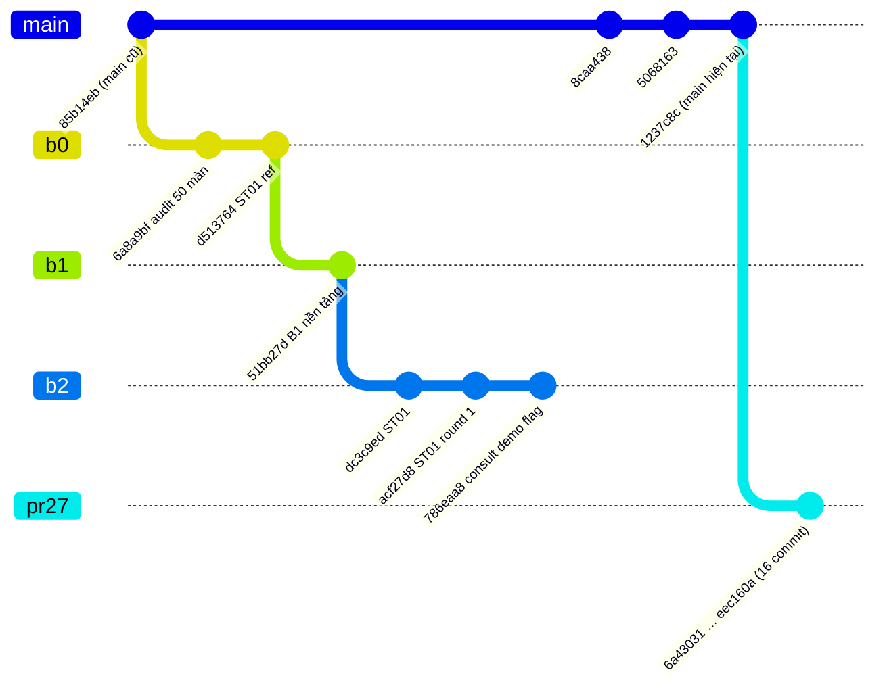

# Kế hoạch tích hợp frontend PGS

| Mục | Giá trị |
|---|---|
| Ngày lập | 2026-10-16 |
| `main` | `1237c8c736fd5ce6b888122a18132b6daf4d3909` |
| PR #27 (`feat/services-foundation`) | `eec160a5e8706bb83b4ee947aa319dc6f62b7757` |
| B0 `docs/frontend-route-audit` | `d513764` (2 commit trên `85b14eb`) |
| B1 `feat/frontend-b1-foundation` | `51bb27d65762` (nối tiếp B0) |
| B2 `feat/frontend-b2-st01` | `786eaa8bef0c` (nối tiếp B1) |
| Figma "Hệ Thống Figma PGS" | **BLOCKED_BY_FIGMA_ACCESS** — connector Figma đã kết nối nhưng trả lỗi hết hạn mức gọi MCP của gói Starter; không đọc được file trong phiên này |

Nguồn tham chiếu thiết kế tạm thời: `docs/frontend/design-system.md`, `packages/config/tailwind-preset.js` (trên B1/B2) và ảnh tham chiếu đã commit trong `docs/frontend/references/` của B2. Tài liệu này **không** khẳng định UI nào khớp Figma.

---

## 1. Đồ thị nhánh

| Nhánh | Base | Ahead/behind `main` | PR | CI |
|---|---|---|---|---|
| B0 | `85b14eb` | +2 / −3 | chưa tạo | chưa từng chạy |
| B1 | B0 | +3 / −3 | chưa tạo | chưa từng chạy |
| B2 | B1 | +6 / −3 | chưa tạo (B2 ghi: GitHub CLI hết quyền) | chưa từng chạy |
| PR #27 | `1237c8c` | +16 / 0 | #27 open | xem [QA](../qa/services-foundation-validation.md) |
| PR #23 | cũ | — | #23 open, `dirty` | 12/12 job đỏ — **không xếp chồng bất cứ thứ gì lên PR #23** |

`ci.yml` chỉ chạy cho PR vào `main` và push vào `main`, nên B0–B2 chưa có bằng chứng CI nào. Kết quả kiểm thử trong `docs/frontend/progress.md` của B1/B2 là do nhóm frontend tự chạy (container cục bộ), chưa được CI xác nhận.

**Kiểm tra độc lập trong phiên này (2026-10-16, worktree riêng, HEAD B2 `786eaa8`):** `pnpm install --frozen-lockfile` PASS · `pnpm lint` 11/11 · `pnpm typecheck` 17/17 · `pnpm test` 17/17 task, 754 test pass. Build, E2E và acceptance của B2 **chưa chạy** — chi tiết ở [QA §7](../qa/services-foundation-validation.md). B1 là tổ tiên trực tiếp của B2, nên các file của B1 cũng nằm trong lượt kiểm tra này.

---

## 2. Xung đột (kiểm bằng `git merge-tree`, không merge thật)

| Cặp | Xung đột |
|---|---|
| B2 ↔ `main` | không |
| B0 ↔ PR #27 | không |
| B1 ↔ PR #27 | không |
| **B2 ↔ PR #27** | `apps/web/app/components/site-header.tsx`, `.env.production.example`, `docs/deployment/environment-matrix.md` |
| B2 ↔ PR #27 (sửa cùng file, tự merge được) | `apps/web/app/lib/server-api.ts` |

Cách giải quyết từng file khi rebase B2 lên `main` (sau khi PR #27 merge):

| File | B2 làm gì | PR #27 làm gì | Giải quyết |
|---|---|---|---|
| `site-header.tsx` | viết lại header theo ST01 (menu, logo, tìm kiếm) | thêm mục `Dịch vụ` hiển thị theo `GET /v1/features` (`feature: "services"`) | giữ header của B2, thêm lại mục `Dịch vụ` với cùng cơ chế ẩn theo flag; không ghép tay từng dòng |
| `.env.production.example` | thêm `FEATURE_CONSULT_FORM_DEMO` | thêm `FEATURE_SERVICES`, `SERVICE_INQUIRY_IP_SALT` | giữ cả ba biến |
| `environment-matrix.md` | thêm dòng `FEATURE_CONSULT_FORM_DEMO` | thêm 5 dòng Services | giữ tất cả |
| `server-api.ts` | thêm hàm cho trang chủ | thêm `listServices`/`getService` | git tự merge; chạy lại `services-fetch.spec.ts` sau rebase |

---

## 3. Design system cần giữ

Giữ nguyên quyết định của B1 (`docs/frontend/design-system.md` trên B1):

- Một preset Tailwind dùng chung cho 3 app: `packages/config/tailwind-preset.js`; token dạng kênh RGB trong CSS variables (`brand #3155D9`, `ink`, `body`, `muted #5B6B82`, `canvas`, `surface`, `line`, `warm`, `navy`, `success/warning/danger`).
- Font Be Vietnam Pro qua `next/font` (subset `vietnamese`).
- Class thành phần trong preset: `.container-site`, `.btn*`, `.card`, `.field-*`, `.eyebrow`, `.h1`, `.h2`, `.link`. Nút/ô nhập cao tối thiểu 44 px.

**Tương thích với trang Services của PR #27 (đã đối chiếu preset trên B1):**

| Trang | Class đang dùng | Có trong preset B1? | Hệ quả khi B1 merge |
|---|---|---|---|
| Storefront `/services`, `/services/[slug]`, form | `container-site`, `card`, `btn-primary`, `btn-buy`, `btn-ghost`, `field-label`, `field-input`, `text-ink`, `text-muted`, `bg-brand-soft`, `text-cta`, `bg-canvas`, `text-danger`, `shadow-card`, `max-w-site` | Có (gồm alias `cta`, `primary`, `btn-buy`) | tự đổi sang bảng màu mới, **không cần sửa code** |
| Portal `/services/**` | hex cứng `#0037b0`, `slate-*` (giống các trang portal hiện có) | không dùng token | cần chuyển sang token + component B1 (Batch 3) |
| Admin `/service*` | hex cứng `#0037b0`, `gray-*` (giống admin hiện có) | không dùng token | cần chuyển sang shell + component B1 (Batch 3 / B5) |

---

## 4. Component tái sử dụng

| Component | Nguồn | Dùng ở đâu khi tích hợp Services | Thay thế cái gì |
|---|---|---|---|
| `PageHeader`, `Breadcrumbs` | B1 `packages/ui/src/layout.tsx` | mọi trang Services ở portal/admin | tiêu đề tự dựng + `ServicesNav` (admin) |
| `DataTable` | B1 `data-table.tsx` | admin danh mục, yêu cầu, dự án | bảng HTML tự dựng |
| `Dialog` (confirm) | B1 `dialog.tsx` | xác nhận convert, đóng dự án, gỡ nhân sự, chia sẻ tài liệu | `window.confirm` (`apps/admin/app/lib/permissions.ts` — placeholder có chủ đích) |
| `FormField` | B1 `form.tsx` | form admin danh mục, form chuyển dự án | label/input tự dựng |
| `LoadingState`/`EmptyState`/`ErrorState` | B1 `states.tsx` | portal/admin Services | `apps/portal/app/components/{empty,error}-state.tsx`, text "Loading…" ở admin |
| `Toast` | B1 `toast.tsx` | phản hồi sau thao tác admin | thông báo inline |
| `SystemPage` | B1 `system-page.tsx` | 403/404/500 | — |
| `Badge`, `Button`, `Card` | `@nexus/ui` hiện có | giữ | — |
| `ProjectStatusBadge`, `MilestoneStatusBadge` | PR #27 `apps/portal/app/services/badges.tsx` | chuyển lên `@nexus/ui` khi admin cần dùng chung | `PROJECT_VARIANT`/`INQUIRY_VARIANT` trong `apps/admin/app/components/services-nav.tsx` |

Không tạo lại component nào đã có trong `@nexus/ui` (B1).

---

## 5. Route inventory (Services Foundation — ngoài danh sách 50 màn)

| ID đề xuất | App | Route | Trạng thái code | Quyết định Q2 (admin → `/admin/*`) |
|---|---|---|---|---|
| SV01 | web | `/services` | PR #27 | — |
| SV02 | web | `/services/[slug]` (+ form yêu cầu `#inquiry`) | PR #27 | — |
| SV03 | portal | `/services` | PR #27 | — |
| SV04 | portal | `/services/projects/[id]` | PR #27 | — |
| SV05 | portal | `/services/inquiries/[id]` | PR #27 | — |
| SV06 | admin | `/services` | PR #27 | chuyển thành `/admin/services` ở B5, route cũ 308 |
| SV07 | admin | `/service-inquiries`, `/service-inquiries/[id]` | PR #27 | → `/admin/service-inquiries…` |
| SV08 | admin | `/service-projects`, `/service-projects/[id]` | PR #27 | → `/admin/service-projects…` |

Các trang admin của PR #27 đặt ở gốc giống `/content`, `/automation` hiện có trên `main`. Quyết định Q2 (trong `implementation-plan.md` của B2) áp dụng cho cả nhóm này khi làm B5; không đổi route trong PR #27 để giữ phạm vi.

---

## 6. Ma trận 50 màn + Services

Quy ước cột: **Figma** Available / Unavailable / Not reviewed · **Code** Implemented / Partial / Missing · **API** Real / Mock / Missing · **Responsive** Passed / Failed / Not tested · **Test** Unit / E2E / Manual / Not run · **Status** Approved / Review / Blocked / Not started.

- **Figma = Not reviewed** cho mọi màn: BLOCKED_BY_FIGMA_ACCESS. Tài liệu B2 ghi "50/50 design (Figma, chờ duyệt)" — không kiểm chứng được trong phiên này.
- **Code** đánh giá trên `main`: route có sẵn nhưng chưa làm lại theo thiết kế mới = *Partial*; route chưa có = *Missing*. Code chỉ tồn tại trên nhánh chưa merge được ghi rõ nhánh.
- **Responsive/Test** chỉ ghi *Passed* khi được chạy trong phiên này trên commit ghi kèm. Kết quả do nhóm B2 tự báo cáo được ghi riêng, không tính là bằng chứng cho commit mới.

| Screen ID | App | Route | Figma | Code | API | Responsive | Test | Status |
|---|---|---|---|---|---|---|---|---|
| ST01 | web | `/` | Not reviewed | Partial (main) · Implemented trên B2 | Real (catalog, CMS) · form tư vấn **Mock** (`DEMO_ONLY` trên B2) → API thật có sẵn qua PR #27 | Not tested (phiên này) · B2 tự báo Passed @`786eaa8` | Not run (phiên này) · B2 tự báo Unit + E2E | Review |
| ST02 | web | `/products` | Not reviewed | Partial | Real | Not tested | Not run | Not started |
| ST03 | web | `/products/[slug]` | Not reviewed | Partial | Real | Not tested | Not run | Not started |
| ST04 | web | `/cart` | Not reviewed | Partial | Real | Not tested | Not run | Not started |
| ST05 | web | `/checkout` | Not reviewed | Partial | Real | Not tested | Not run | Not started |
| ST06 | web | `/orders/[id]` | Not reviewed | Partial | Real | Not tested | Not run | Not started |
| ST07 | web | `/orders/[id]` (đã thanh toán) | Not reviewed | Partial | Real | Not tested | Not run | Not started |
| ST08 | web | `/login` | Not reviewed | Partial | Real (Supabase) | Not tested | Not run | Not started |
| ST09 | web | `/register` | Not reviewed | Partial | Real (Supabase) | Not tested | Not run | Not started |
| ST10 | web | `/forgot-password`, `/reset-password` | Not reviewed | Missing | Real (Supabase SDK; cần cấu hình redirect) | Not tested | Not run | Not started |
| ST11 | web | `/blog`, `/blog/category/[slug]` | Not reviewed | Partial | Real | Not tested | Not run | Not started |
| ST12 | web | `/blog/[slug]` | Not reviewed | Partial | Real | Not tested | Not run | Not started |
| ST13 | web | trang chính sách | Not reviewed | Missing | **Missing** (public chỉ trả `ARTICLE`) | Not tested | Not run | Blocked |
| PT01 | portal | `/` | Not reviewed | Partial | Real (không có `total`) | Not tested | Not run | Not started |
| PT02 | portal | `/entitlements` | Not reviewed | Partial | Real | Not tested | Not run | Not started |
| PT03 | portal | `/downloads` | Not reviewed | Partial | Real | Not tested | Not run | Not started |
| PT04 | portal | `/entitlements/[id]` | Not reviewed | Partial | Real | Not tested | Not run | Not started |
| PT05 | portal | `/licenses` | Not reviewed | Partial | Real | Not tested | Not run | Not started |
| PT06 | portal | `/licenses/[id]` | Not reviewed | Partial | Real | Not tested | Not run | Not started |
| PT07 | portal | `/allocations` + `/licenses/[id]` | Not reviewed | Partial | Real (external) · kích hoạt nội bộ từ portal: Missing | Not tested | Not run | Not started |
| PT08 | portal | `/orders` | Not reviewed | Partial | Real (không có `total`) | Not tested | Not run | Not started |
| PT09 | portal | `/orders/[id]` | Not reviewed | Partial | Real | Not tested | Not run | Not started |
| PT10 | portal | `/tickets` | Not reviewed | Partial | Real | Not tested | Not run | Not started |
| PT11 | portal | `/tickets/[id]` | Not reviewed | Partial | Real | Not tested | Not run | Not started |
| PT12 | portal | `/notifications` | Not reviewed | Implemented (UI cũ) | Real | Not tested | Not run | Not started |
| PT13 | portal | `/account` | Not reviewed | Partial | Real (đọc) · **Missing** (cập nhật hồ sơ) | Not tested | Not run | Not started |
| PT14 | portal | `/account/security` | Not reviewed | Missing | Real (đổi mật khẩu qua Supabase) · 2FA: chưa xác nhận (Q5) | Not tested | Not run | Blocked (phần 2FA) |
| AD01 | admin | `/login` | Not reviewed | Partial | Real | Not tested | Not run | Not started |
| AD02 | admin | `/` | Not reviewed | Partial (trang chẩn đoán dev) | Real (không có endpoint tổng hợp) | Not tested | Not run | Not started |
| AD03 | admin | `/admin/products` | Not reviewed | Partial | Real | Not tested | Not run | Not started |
| AD04 | admin | `/admin/products/new`, `/[id]` | Not reviewed | Partial | Real | Not tested | Not run | Not started |
| AD05 | admin | `/admin/products/[id]/versions` | Not reviewed | Missing | Real | Not tested | Not run | Not started |
| AD06 | admin | `/admin/categories` | Not reviewed | Missing | Real | Not tested | Not run | Not started |
| AD07 | admin | `/admin/products/[id]/pricing` | Not reviewed | Partial | Real | Not tested | Not run | Not started |
| AD08 | admin | `/admin/orders` | Not reviewed | Partial | Real | Not tested | Not run | Not started |
| AD09 | admin | `/admin/orders/[id]` | Not reviewed | Missing | Real | Not tested | Not run | Not started |
| AD10 | admin | `/admin/payments/[id]` | Not reviewed | Missing | Real (từng payment) · hàng đợi đối soát: **Missing** | Not tested | Not run | Not started |
| AD11 | admin | `/admin/entitlements` | Not reviewed | Missing | Real | Not tested | Not run | Not started |
| AD12 | admin | `/admin/licenses` | Not reviewed | Missing | Real | Not tested | Not run | Not started |
| AD13 | admin | `/admin/allocations` | Not reviewed | Missing | Real | Not tested | Not run | Not started |
| AD14 | admin | `/admin/users` | Not reviewed | Missing | Real · gán role bị khóa theo chính sách | Not tested | Not run | Blocked (gán role) |
| AD15 | admin | `/admin/tickets` | Not reviewed | Missing | Real | Not tested | Not run | Not started |
| AD16 | admin | `/admin/tickets/[id]` | Not reviewed | Missing | Real | Not tested | Not run | Not started |
| AD17 | admin | `/content` → `/admin/content` | Not reviewed | Partial | Real | Not tested | Not run | Not started |
| AD18 | admin | `/content/new`, `/[id]` | Not reviewed | Partial | Real | Not tested | Not run | Not started |
| AD19 | admin | `/content/categories` (+ media) | Not reviewed | Partial | Real (danh mục) · media: **Missing** | Not tested | Not run | Not started |
| AD20 | admin | `/automation`, `/automation/[id]` | Not reviewed | Partial | Real | Not tested | Not run | Not started |
| SY01 | portal, admin | `/403` | Not reviewed | Implemented trên B1 (chưa merge) | — | Not tested | Not run | Review |
| SY02 | web, portal, admin | `not-found.tsx` | Not reviewed | Partial (main: web) · Implemented trên B1 | — | Not tested | Not run | Review |
| SY03 | web, portal, admin | `error.tsx`, `global-error.tsx` | Not reviewed | Partial (main: web) · Implemented trên B1 | — | Not tested | Not run | Review |
| SV01 | web | `/services` | Not reviewed | Implemented (PR #27) | Real | **Passed** 1440/768/390 @`eec160a` | Unit, Integration, Manual (Playwright) | Review |
| SV02 | web | `/services/[slug]` + form | Not reviewed | Implemented (PR #27) | Real (`POST /v1/service-inquiries` đã gửi thật, 201) | **Passed** 1440/768/390 @`eec160a` | Unit, Integration, Manual (Playwright) | Review |
| SV03 | portal | `/services` | Not reviewed | Implemented (PR #27) | Real | **Passed** 1440/768/390 @`eec160a` (sau fix F-03) | Integration, Manual (Playwright) | Review |
| SV04 | portal | `/services/projects/[id]` | Not reviewed | Implemented (PR #27) | Real | **Passed** 1440/768/390 @`eec160a` | Integration, Manual (Playwright) | Review |
| SV05 | portal | `/services/inquiries/[id]` | Not reviewed | Implemented (PR #27) | Real | **Passed** 1440/768/390 @`eec160a` | Integration, Manual (Playwright) | Review |
| SV06 | admin | `/services` | Not reviewed | Implemented (PR #27) | Real | **Passed** 1440/768/390 @`eec160a` (390: bảng cuộn ngang trong khung) | Unit, Integration, Manual (Playwright) | Review |
| SV07 | admin | `/service-inquiries`, `/[id]` | Not reviewed | Implemented (PR #27) | Real | **Passed** 1440/768/390 @`eec160a` | Unit, Integration, Manual (Playwright) | Review |
| SV08 | admin | `/service-projects`, `/[id]` | Not reviewed | Implemented (PR #27) | Real | **Passed** 1440/768/390 @`eec160a` | Unit, Integration, Manual (Playwright) | Review |

Tổng hợp 50 màn: **0/50 Approved**, 4 Review (ST01, SY01–SY03 — đều nằm trên nhánh chưa merge), 3 Blocked toàn phần hoặc một phần (ST13, PT14, AD14), còn lại Not started. Không gom 50 màn thành một trạng thái chung.

---

## 7. Tích hợp ST01 với API yêu cầu thật (thay `POST /v1/leads` đề xuất của B2)

B2 đề xuất API mới `POST /v1/leads` (đề xuất P3). PR #27 đã có `POST /v1/service-inquiries` với cùng các biện pháp: rate limit Redis theo IP + email (fail-closed), honeypot, `ip_hash`, idempotency, audit. Khuyến nghị **không tạo đường tiếp nhận thứ hai**: xóa form `DEMO_ONLY` và gửi thẳng tới `POST /v1/service-inquiries`.

| Trường form ST01 (B2) | `CreateServiceInquiryDto` | Ghi chú |
|---|---|---|
| Họ tên | `contactName` (bắt buộc, ≤120) | |
| Email | `contactEmail` (bắt buộc) | |
| Điện thoại | `contactPhone` (tùy chọn, `^\+?[0-9 .()-]{8,20}$`) | regex B2 chặt hơn — giữ kiểm tra phía client nhưng backend là chuẩn |
| Loại website | `serviceSlug` (bắt buộc, phải là dịch vụ `ACTIVE`) | ánh xạ lựa chọn sang slug dịch vụ; nếu cần mục "Tư vấn chung", admin tạo thêm một dịch vụ — không đổi API |
| Nội dung | `requirements` (bắt buộc, ≤5000) | B2 để tùy chọn → form phải bắt buộc |
| *(không có)* | `companyName` (bắt buộc, ≤200) | thêm ô "Tên doanh nghiệp" vào form, hoặc đề xuất backend cho phép bỏ trống (PR riêng) |
| Đồng ý | *(không có trong DTO)* | **khoảng trống** — xem phát hiện F-12 trong [review](../audit/services-foundation-pr27-review.md); cần quyết định của chủ dự án trước khi bật trên production |
| *(ẩn)* | `website` (honeypot), `submissionKey` (UUID mỗi lần mở form) | bắt buộc gửi kèm như form `/services/[slug]` |

Phản hồi form phải xử lý: `201 { inquiryNumber }` → hiển thị mã; `400` → lỗi theo trường; `404` → dịch vụ không còn nhận yêu cầu / module tắt; `409` → key đã dùng với email khác; `429` → "gửi quá nhanh"; `503` → giữ dữ liệu đã nhập, cho thử lại.

---

## 8. Kế hoạch merge theo batch

| Batch | Nội dung | Phụ thuộc | Điều kiện vào | Điều kiện ra |
|---|---|---|---|---|
| **0** | Review + merge PR #27 | — | review này, CI xanh trên HEAD mới nhất | merge vào `main` (chủ dự án quyết) |
| **1** | Mở PR cho B0 + B1, rebase lên `main` mới | Batch 0 | không xung đột với PR #27 (đã kiểm) | CI xanh; `Dialog`, `DataTable`, `States`, preset có trên `main` |
| **2** | Rebase B2 lên `main` + B1; giải 3 xung đột (§2); thay form tư vấn bằng API thật (§7) trong commit riêng | Batch 1 + quyết định consent (F-12) | | CI xanh; E2E ST01 chạy lại trên commit mới |
| **3** | `feat/frontend-services-b1-adoption`: portal/admin Services dùng token + component B1 (`Dialog` thay `window.confirm`, `DataTable`, `States`, `PageHeader`) | Batch 1 | | Playwright 1440/768/390 cho SV01–SV08; không đổi API |
| **4** | B3 Storefront (ST02–ST12) | Batch 2 | | theo DoD của B2 |
| **5** | B4 Portal (PT01–PT14) | Batch 1 | | |
| **6** | B5 Admin 1 (AD01–AD09) + chuẩn hóa `/admin/*` (gồm SV06–SV08, 308 từ route cũ) | Batch 3 | | |
| **7** | B6 Admin 2 (AD10–AD20) | Batch 6 | | |
| **8** | B7 mô phỏng, B8 QA toàn bộ | các batch trên | | |

Không merge thẳng B1/B2 vào `main`. Mỗi batch là một PR riêng, rebase (không cherry-pick hàng loạt), giải xung đột theo logic từng file.

---

## 9. Blocker

### Backend

| # | Blocker | Ảnh hưởng | Hướng xử lý |
|---|---|---|---|
| BE-1 | Không có endpoint public cho trang `PAGE` | ST13 | PR backend riêng (B2 Q4 ưu tiên) |
| BE-2 | List khách hàng không trả `total` | PT01, PT08 | PR backend riêng |
| BE-3 | Không có API cập nhật hồ sơ | PT13 | PR backend riêng |
| BE-4 | Không có list payment cần đối soát | AD10 | PR backend riêng |
| BE-5 | Không có media library / API ảnh sản phẩm | AD04, AD19, ST01 showcase | đề xuất P2 của B2 (bucket public tách riêng) |
| BE-6 | Không có cờ nổi bật / vị trí trưng bày | ST01 showcase | đề xuất P1 của B2 (`product_placements`) |
| BE-7 | Consent trên form yêu cầu dịch vụ | ST01, SV02 | quyết định F-12 |
| BE-8 | Thông báo yêu cầu mới/cập nhật dự án | vận hành Services | event outbox + worker handler (PR riêng) |

### Frontend

| # | Blocker | Hướng xử lý |
|---|---|---|
| FE-1 | BLOCKED_BY_FIGMA_ACCESS (hết hạn mức MCP gói Starter) | nâng gói Figma hoặc export frame/spec vào repo |
| FE-2 | B0–B2 chưa có PR → chưa có CI | tạo PR (cần quyền GitHub) |
| FE-3 | Máy của nhóm B1 bật Application Control chặn `turbo.exe` và SWC native (theo `progress.md`) | tiếp tục chạy trong container hoặc dựa vào CI |
| FE-4 | Supabase MFA chưa xác nhận (Q5) | PT14 |

---

## 10. Thứ tự triển khai tối ưu

1. Merge PR #27 → có API yêu cầu thật trên `main`.
2. B0 + B1 → có design system và component dùng chung trên `main`.
3. B2 rebase + nối form ST01 vào `POST /v1/service-inquiries` → bỏ được `DEMO_ONLY` đầu tiên bằng API thật.
4. Services dùng component B1 (Batch 3) — thay `window.confirm`.
5. Song song: B3 (Storefront) và B4 (Portal); sau đó B5/B6 (Admin, kèm chuẩn hóa `/admin/*`).
6. Unified Quotation ([RFC](../architecture/unified-quotation-rfc.md)) bắt đầu sau bước 1; frontend báo giá dùng component của bước 2.
